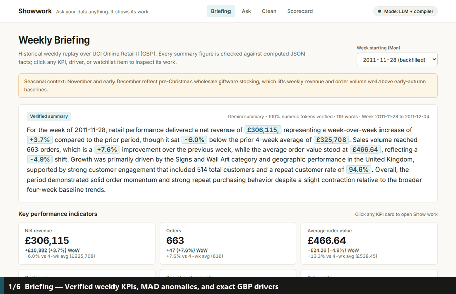

# Showwork

**Ask your data anything. It shows its work.**

[](https://github.com/ANUSHKA13102003/showwork/actions/workflows/ci.yml)



Showwork is a measured semantic-layer copilot over real UK giftware transactions from UCI Online Retail II (Dec 2009 to Dec 2011, GBP). The LLM never writes a number or runs SQL it wrote: code compiles governed metrics into read-only DuckDB SQL and attaches a Show work panel to every figure. On held-out test questions, Showwork reached **100.0% answer-value accuracy** (14/14, 95% CI 78.5–100.0%) versus **0.0%** (0/14, 95% CI 0.0–21.5%) for a plain-LLM baseline, and handled **100.0%** (6/6, 95% CI 61.0–100.0%) of refusals and prompt injections. Try it at https://showwork.onrender.com. The live app runs on a free host and may take about a minute to wake up on first visit. A static copy is always available here: https://anushka13102003.github.io/showwork/.

## What is inside

- **Briefing (`/briefing`)**: Replayed weekly KPI cards (WoW and vs prior 4-week average), exact GBP driver splits, 8-week median/MAD anomaly flags, deterministic watchlist, and fact-verified narratives.
- **Ask (`/ask`)**: Plain-English metric queries and "why did revenue change?" driver breakdowns with clickable Show work inspection and a no-key rule-based fallback.
- **Clean (`/clean`)**: In-memory CSV Data Doctor (`<= 5 MB`) that detects 6 issue types deterministically, previews row-count impact per accepted fix, and neutralises spreadsheet formula injection (`= + - @`) on download.
- **Scorecard (`/scorecard`)**: Held-out benchmark scores with 95% Wilson intervals, plain-LLM baseline comparison, prompt-injection outcomes, metric dictionary, and quarantine breakdown.

## Run locally

```bash
python -m venv .venv
# Windows: .venv\Scripts\activate   |   macOS/Linux: source .venv/bin/activate
pip install -r requirements.txt
python run_all.py
uvicorn app.main:app
```

Copy `.env.example` to `.env` to set `GEMINI_API_KEY` if you want LLM translation and narrative drafting; without a key, Briefing, Clean, Scorecard, and rule-based Ask all work offline.

## How it works

```text
UCI Online Retail II Excel (1,067,371 raw rows)
  |
  +--> pipeline/clean.py -----> 1,021,252 clean rows (sales + C-invoice returns)
  |                         \-> 46,119 quarantined rows with explicit reason codes
  |
  +--> pipeline/categories.py -> regex (90.8%) -> rapidfuzz (0.2%) -> temp-0 LLM (9.0%) -> 18 categories
  |
  v
data/lines.parquet (10.5 MB) --> read-only DuckDB (lines, sales, returns)
  |
  +--> Ask: Question -> injection guard -> Gemini JSON intent (or rule parser) -> Pydantic whitelist
  |         -> parameterised SQL from pipeline/metrics.yml -> code-built sentence + Show work
  |
  +--> Briefing: Weekly JSON facts -> <=200-word draft -> app/verifier.py number check -> retry/template
```

## Evaluation results

`evals/run.py` scores 40 questions (20 `dev`, 20 held-out `test`: 28 answerable, 8 refusals/clarifications, 4 prompt injections) against an independent plain-`pandas` ground truth, reporting 95% Wilson confidence intervals. Prompts were tuned only on `dev`.

| System / Mode | Split | Request-match accuracy | Answer-value accuracy | Refusal / injection accuracy |
| :--- | :--- | ---: | ---: | ---: |
| **Showwork (LLM + compiler)** | `dev` | 92.9% (13/14, CI 68.5–98.7%) | 100.0% (14/14, CI 78.5–100.0%) | 100.0% (6/6, CI 61.0–100.0%) |
| **Showwork (LLM + compiler)** | `test` | 92.9% (13/14, CI 68.5–98.7%) | 100.0% (14/14, CI 78.5–100.0%) | 100.0% (6/6, CI 61.0–100.0%) |
| **Showwork (No-key rule mode)** | `dev` | 100.0% (14/14, CI 78.5–100.0%) | 100.0% (14/14, CI 78.5–100.0%) | 100.0% (6/6, CI 61.0–100.0%) |
| **Showwork (No-key rule mode)** | `test` | 92.9% (13/14, CI 68.5–98.7%) | 92.9% (13/14, CI 68.5–98.7%) | 100.0% (6/6, CI 61.0–100.0%) |
| **Plain LLM (schema + 50 rows)** | `dev` | n/a | 7.1% (1/14, CI 1.3–31.5%) | 100.0% (6/6, CI 61.0–100.0%) |
| **Plain LLM (schema + 50 rows)** | `test` | n/a | 0.0% (0/14, CI 0.0–21.5%) | 100.0% (6/6, CI 61.0–100.0%) |

Weekly briefing summary verifier (`evals/results.json` -> `briefing_verifier`): **0.0% first-pass failure rate** (`0/8` backfilled weeks failed numeric verification; `100.0%` final verified pass rate). Adversarial unit tests verify that injected numeric hallucinations trigger retry and template fallback.

Recorded failures:
- `Showwork (No-key)` on `test_04` (*"How many customers placed orders in 2010?"*): keyword rule matched `orders` (`19,627`) ahead of `customers` (`4,205`). Showwork LLM mode returned `4,205`.
- `Showwork (LLM)` on `dev_14` and `test_14`: answered with exact values (`£1,299,552.88` and `£591,767.18`), but emitted `limit=1` on ungrouped scalar queries where the strict request matcher expected `limit=20`.
- `Plain-LLM baseline`: missed 13/14 `dev` and 14/14 `test` answerable questions (within a 1% tolerance) because full-table totals over `1,021,252` rows cannot be inferred from schema metadata and 50 sample rows.

## Data source and limitations

- **Dataset & licence**: UCI Machine Learning Repository, *Online Retail II* by Dr. Daqing Chen (`https://doi.org/10.24432/C5CG6D`), licensed under **CC BY 4.0** (downloaded from the matching two-sheet UCI workbook on Kaggle `lakshmi25npathi/online-retail-dataset` with UCI archive fallback).
- **Replayed weekly feed**: weekly briefings and `.github/workflows/weekly.yml` replay the historical `2009–2011` transaction stream week by week rather than ingesting live orders.
- **Single retailer**: reflects one UK wholesaler-heavy giftware merchant (`22.24%` guest lines without Customer ID, sharp November pre-Christmas wholesale peaks).
- **Inflated early "new customer" cohorts**: `customer_type = 'new'` means first seen in this dataset starting `2009-12-01`; buyers active before December 2009 appear new on their first recorded order.
- **Derived categories are not ground truth**: Online Retail II has no category field, so categories come from product descriptions (`4,302` by regex rules, `9` by fuzzy match, `426` by cached LLM). Hiding `120` rule-labelled products from the LLM produced `65.0%` agreement — a consistency check, not ground truth.
- **Small self-written benchmark & sample-limited baseline**: the 40-question suite was authored alongside the schema, and the plain-LLM baseline sees only schema metadata and 50 sample rows rather than executing SQL.
- **Free-tier limits & in-memory counter**: Gemini free-tier rate limits apply, and the daily LLM call cap (`150` calls/day default) is stored in process memory and resets on server restart.
